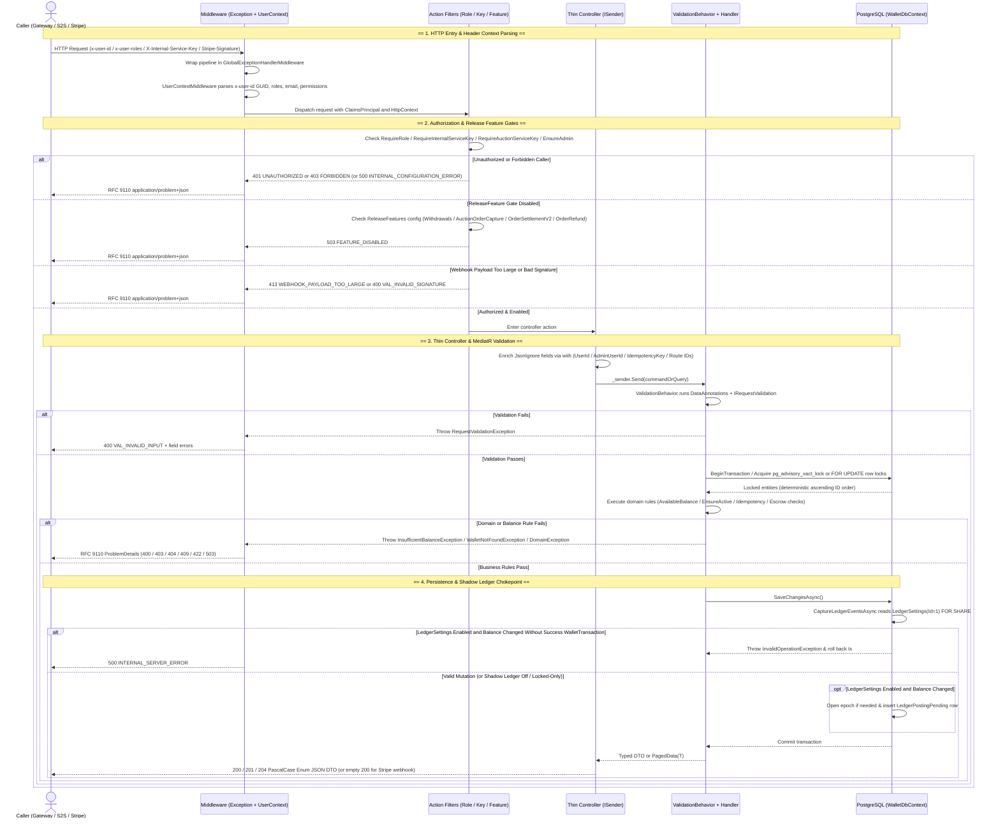

# Shared Request and Response Path — Sequence Diagram

[Detailed walkthrough](00-shared-request-path.md) | [Business overview](../business-use-cases.md) | [Docs index](../README.md)

End-to-end HTTP execution pipeline inside `WalletService` (`GlobalExceptionHandlerMiddleware` -> `UserContextMiddleware` -> authorization and `[ReleaseFeature]` filters -> thin controller `ISender` -> MediatR `ValidationBehavior` -> handler -> `WalletDbContext.SaveChangesAsync` shadow-ledger guard).

