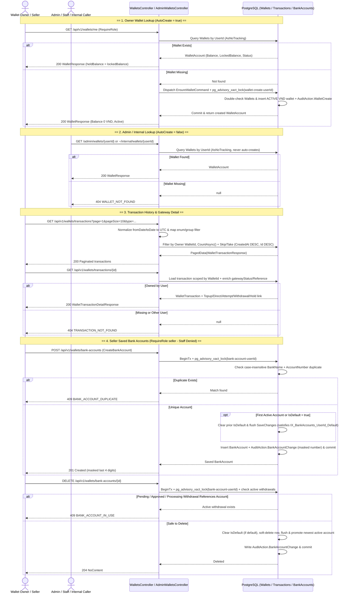

# View Wallet, History, and Saved Bank Accounts — Sequence Diagram

[Detailed walkthrough](01-wallet-and-history.md) | [Business overview](../business-use-cases.md) | [Shared request path](00-shared-request-path.md)

Covers owner wallet lookup with concurrency-safe auto-creation, read-only admin/internal wallet inspection (`AutoCreate = false`), paginated transaction history and gateway detail enrichment, and seller saved bank-account lifecycle (`IX_BankAccounts_UserId_Default`).

