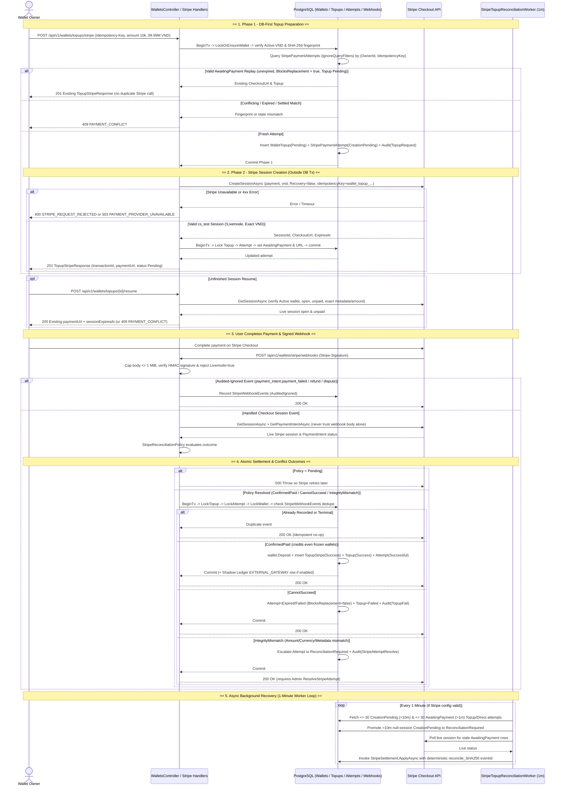

# Stripe Wallet Top-Up — Sequence Diagram

[Detailed walkthrough](02-stripe-topup.md) | [Business overview](../business-use-cases.md) | [Shared request path](00-shared-request-path.md)

Two-phase DB-first Stripe Checkout top-up lifecycle: phase 1 reserves an idempotent attempt, Stripe session creation runs outside any DB lock, phase 2 commits the checkout URL, and confirmed funds arrive via signed webhook or 1-minute background polling.

