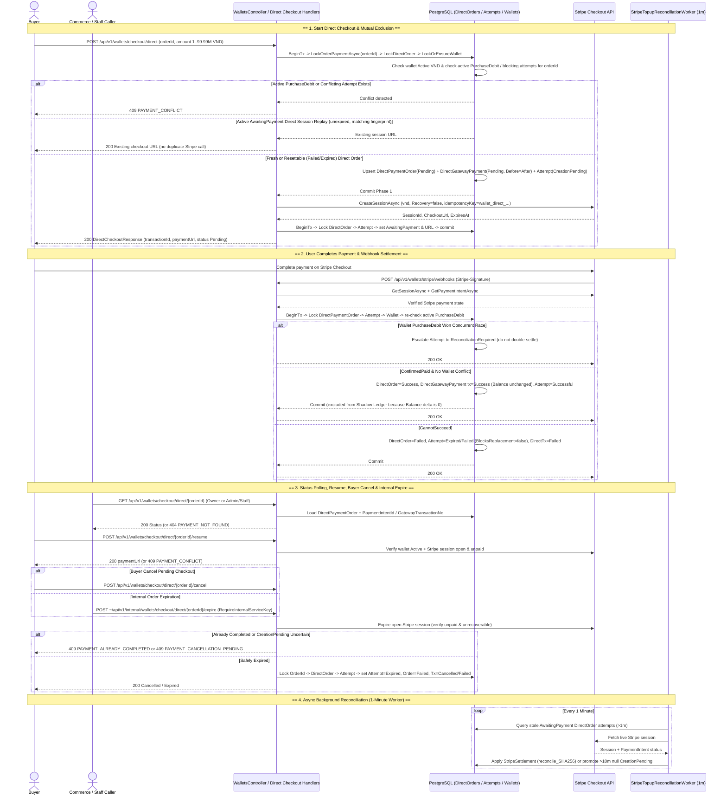

# Direct Stripe Order Checkout — Sequence Diagram

[Detailed walkthrough](03-direct-checkout.md) | [Business overview](../business-use-cases.md) | [Shared request path](00-shared-request-path.md)

Direct order payment via Stripe without debiting wallet balance, enforcing strict mutual exclusion with wallet `PurchaseDebit` and supporting status polling, resume, buyer cancel, internal expiration, and 1-minute background recovery.

