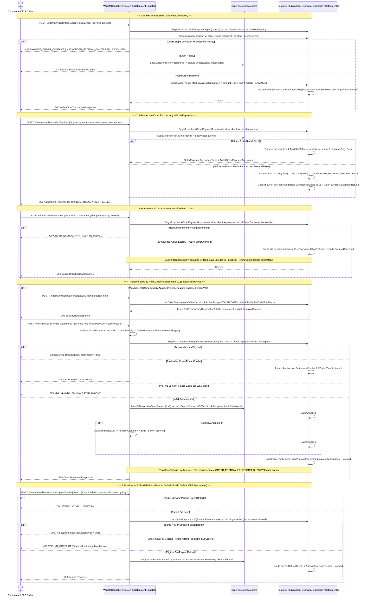
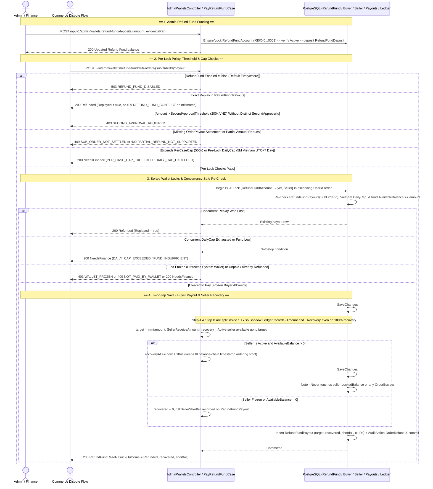

# Wallet Orders, Escrow Lifecycle, Settlements, Subsidies & Refunds — Sequence Diagrams

[Detailed walkthrough (Escrow Deep Dive)](04-wallet-orders.md) | [Business overview](../business-use-cases.md) | [Shared request path](00-shared-request-path.md)

Complete escrow lifecycle across all four mechanisms (`OrderEscrow`, `AuctionDepositEscrow` pool, `PlatformSubsidyBudget` / `Reservation`, and `RefundFundAccount` / `RefundFundPayout`), split into two diagrams for clarity:
- **Diagram 4A:** Order escrow funding, adjustment, cancellation, Platform Subsidy hold, Settlement V2 (`SettleOrderPayout`), and pre-payout refunds (`RefundOrderPayment`).
- **Diagram 4B:** Post-payout Dispute Refund Fund (`PayRefundFundCase` / T30 Phase 1) and best-effort seller recovery.

---

## Diagram 4A — Core Order Escrow, Adjustments, Cancellation, Settlement V2 & Pre-Payout Refunds

---

## Diagram 4B — Post-Payout Refund Fund (T30 Phase 1) & Best-Effort Seller Recovery

