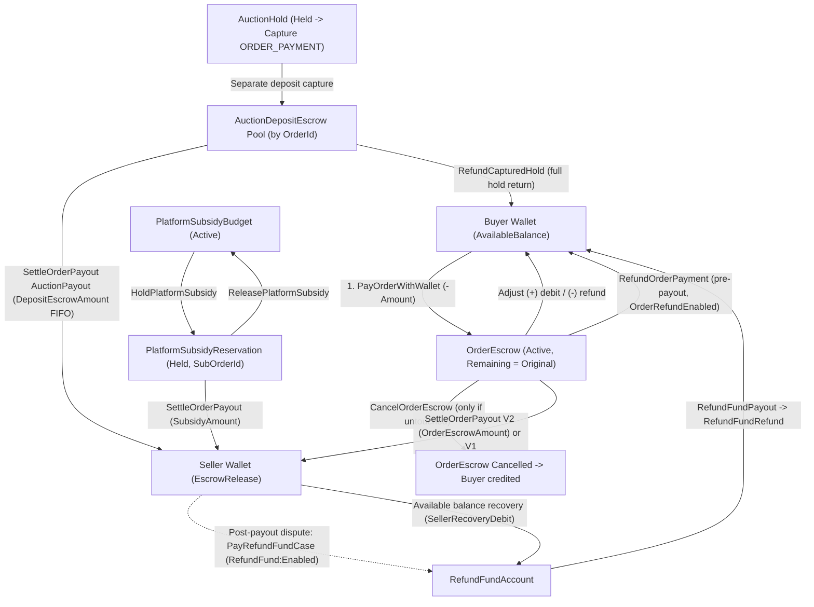
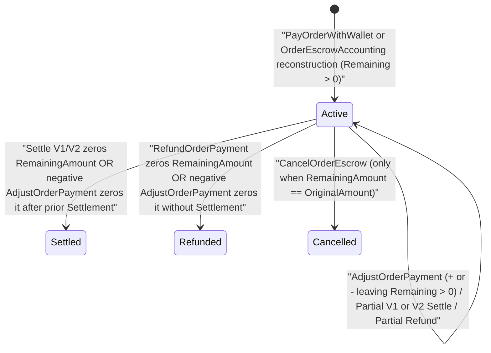

# Pay, settle, adjust, cancel, subsidize, and refund orders (Escrow Deep Dive)

[Business overview](../business-use-cases.md) | [Shared request path](00-shared-request-path.md) | [Shadow ledger & reconciliation](09-shadow-ledger-and-reconciliation.md) | [Sequence diagram](04-wallet-orders.diagram.md)

**Stories:**
- As a buyer, I want my wallet order payment safely held in order escrow until fulfillment finishes or cancels.
- As the Commerce/Settlement pipeline, I want to adjust, cancel, settle (V2 with fees, shipping, auction deposits, and platform subsidies), or refund order/sub-order funds without ever double-spending escrow or stranding funds in frozen wallets.
- As Finance/Operations, I want a strictly capped, dual-admin-approved Refund Fund to reimburse buyers on already-settled wallet orders and recover available seller balances with full ledger traceability.

---

## 1. Escrow Architecture Overview

`WalletService` models order-related held value across **four separate mechanisms** so that buyer payments, captured auction deposits, platform promotional subsidies, and post-payout dispute refunds never mix:

| Mechanism & Entity | Cardinality & Lifecycle Status | Balance Constraints (DB Checks) | What Spends / Modifies It |
|---|---|---|---|
| **Wallet Order Escrow** (`OrderEscrow`) | 1 per wallet-paid `OrderId`. `Status`: `Active (0)`, `Settled (1)`, `Refunded (2)`, `Cancelled (3)`. | `OriginalAmount > 0`, `0 <= RemainingAmount <= OriginalAmount`; `Cancelled` requires `CancelledAt != null` & `CancelReason != null` & `Remaining = 0`. | Created by `PayOrderWithWallet` (or reconstructed on legacy data by `OrderEscrowAccounting`); increased/decreased by `AdjustOrderPayment`; zeroed by `CancelOrderEscrow`, `SettleSellerOrder` (V1), `SettleOrderPayout` (V2), or `RefundOrderPayment`. |
| **Auction Deposit Escrow** (`AuctionDepositEscrow`) | 1 per captured `AuctionHold` (`Purpose = ORDER_PAYMENT`). Multiple rows can share one `OrderId` (Buy Now auction orders can capture both deposit + goods holds). | `OriginalAmount > 0`, whole VND (`trunc`), `0 <= RemainingAmount <= OriginalAmount`. | Created by `CaptureHold(ORDER_PAYMENT)`; drained FIFO (`CreatedAt ASC, Id ASC`) by `SettleOrderPayout(AuctionPayout)`; returned 100% by `RefundCapturedHold`. Independent of `CancelOrderEscrow`. |
| **Platform Subsidy Budget & Hold** (`PlatformSubsidyBudget`, `PlatformSubsidyReservation`) | At most 1 `Active` budget globally; 1 `Held/Released/Used` reservation per `SubOrderId`. | `PerOrderCap <= DailyLimit <= TotalLimit`; `Reserved + Used <= TotalLimit`; 4-eyes `ApprovedByAdminId != CreatedByAdminId`. | Held by `HoldPlatformSubsidy`; released by `ReleasePlatformSubsidy`; converted from `Reserved` to `Used` and credited to seller (`PlatformSubsidyCredit`) inside `SettleOrderPayout`. Never touches `OrderEscrow`. |
| **Refund Fund** (`RefundFundAccount` + `RefundFundPayout`) | 1 singleton system wallet (`f0f0f0f0-0000-0000-0000-000000000001`); 1 `RefundFundPayout` per `SubOrderId`. | `Balance >= 0`; `SellerRecoveryTarget >= 0`, `SellerRecoveredAmount + SellerShortfall = SellerRecoveryTarget`. | Funded by admin `DepositRefundFund`; pays settled sub-order refunds (`PayRefundFundCase`) and recovers available funds from the seller wallet without touching seller `LockedBalance` or any escrow. |

### End-to-End Money & Escrow Flow

### `OrderEscrowStatus` Lifecycle

---

## 2. Stage 1 — Funding Escrow (`PayOrderWithWallet`)

**Routes:**
- Legacy S2S: `POST /api/v1/wallets/orders/{orderId}/payment` (`[RequireInternalServiceKey]`, reads `x-user-id` header as buyer; hidden from Swagger).
- Canonical internal: `POST ~/api/v1/internal/wallets/orders/{orderId}/payment` (`[RequireInternalServiceKey]`, reads `BuyerId` from body or falls back to `x-user-id`).

**Handler ([PayOrderWithWalletCommandHandler](../../Wallet.Application/Features/Checkout/Commands/PayOrderWithWallet/PayOrderWithWalletCommandHandler.cs)):**
1. Validates positive VND `Amount` and non-empty `OrderId` / buyer GUID.
2. Begins transaction; locks order advisory key `LockOrderPaymentAsync(orderId)`, any existing `DirectPaymentOrder` row (`LockDirectPaymentOrderByIdAsync`), then buyer wallet (`LockWalletByUserIdAsync(buyerId)` -> `404 WALLET_NOT_FOUND`).
3. **Mutual exclusion with Direct Stripe checkout:** Checks existing `PurchaseDebit` or `DirectGatewayPayment` (excluding `Failed`/`Cancelled`) and checks `StripePaymentAttempts` (`BlocksReplacement || ReconciliationRequired`). Any Stripe direct payment in flight or completed throws `409 PAYMENT_ORDER_CONFLICT`.
4. **Idempotent replay vs conflict:** If a `PurchaseDebit` already exists for `orderId`:
   - Matching `WalletId` and `Amount`: calls `OrderEscrowAccounting.LoadOrReconcileAsync`; rejects if escrow is `Cancelled` (`409 ORDER_ESCROW_CANCELLED`) or `Refunded` (`409 ORDER_ESCROW_ALREADY_RESOLVED`); commits reconciled escrow if needed; returns existing transaction (`200`).
   - Different payer wallet or amount: throws `409 PAYMENT_ORDER_CONFLICT`.
5. **Fresh debit & escrow creation:** Enforces `wallet.EnsureActive()` (`403 WALLET_FROZEN`) and `AvailableBalance >= Amount` (`400 INSUFFICIENT_BALANCE`). Calls `wallet.Deduct(Amount)`, inserts `PurchaseDebit` (`Status = Success`), inserts `OrderEscrow` (`OriginalAmount = RemainingAmount = Amount`, `Status = Active`), writes `AuditAction.OrderPayment`, commits, and returns `200 WalletOrderTransactionResponse`.

---

## 3. Stage 2 — Adjusting Active Escrow (`AdjustOrderPayment`)

**Route:** `POST ~/api/v1/internal/wallets/orders/{orderId}/adjust-payment` (`[RequireInternalServiceKey]`, requires header `Idempotency-Key` 1–100 ASCII `[A-Za-z0-9-_]`).

**Handler ([AdjustOrderPaymentCommandHandler](../../Wallet.Application/Features/Checkout/Commands/AdjustOrderPayment/AdjustOrderPaymentCommandHandler.cs)):**
Used when order shipping fees or order totals change **while the order escrow is still `Active`**.
1. Computes SHA-256 fingerprint over `(OrderId, BuyerId, DeltaAmount, TrimmedReason)`. `DeltaAmount == 0` is rejected (`400 VAL_INVALID_AMOUNT`).
2. Locks `LockOrderPaymentAsync(orderId)` -> checks `WalletTransactions(ReferenceId == orderId, ClientIdempotencyKey == key)` (same fingerprint replays `200`; mismatch throws `409 IDEMPOTENCY_KEY_REUSED`).
3. Calls `OrderEscrowAccounting.LoadOrReconcileAsync(orderId)` then `LockWalletByUserIdAsync(buyerId)`:
   - Rejects missing payment (`404 PAYMENT_NOT_FOUND`), unrecoverable escrow (`409 ORDER_ESCROW_UNAVAILABLE`), `Cancelled` (`409 ORDER_ESCROW_CANCELLED`), non-`Active` (`409 ORDER_ESCROW_ALREADY_RESOLVED`), or mismatched wallet (`409 PAYMENT_ORDER_CONFLICT`).
4. **Positive delta (`DeltaAmount > 0`, additional charge):**
   - Requires `wallet.EnsureActive()` (`403 WALLET_FROZEN`) and `AvailableBalance >= delta` (`400 INSUFFICIENT_BALANCE`).
   - Deducts wallet; adds `delta` to **both** `escrow.OriginalAmount` and `escrow.RemainingAmount`; records `OrderPaymentAdjustmentDebit`.
5. **Negative delta (`DeltaAmount < 0`, partial refund / reduction):**
   - **Deliberately does NOT call `wallet.EnsureActive()`**, so a frozen buyer wallet still receives order-reduction refunds without stranding funds.
   - Requires `escrow.RemainingAmount >= refundAmount` **and** `escrow.OriginalAmount - refundAmount > 0m` (`409 ORDER_ESCROW_INSUFFICIENT`; DB constraint `CK_OrderEscrows_Balance` forbids zeroing `OriginalAmount`).
   - Credits wallet (`wallet.Deposit`), subtracts `refundAmount` from **both** `OriginalAmount` and `RemainingAmount`, and if `RemainingAmount` reaches `0`, sets `Status = Settled` (when a prior `EscrowRelease` tx or `OrderSettlement` audit exists) or `Refunded`. Records `OrderPaymentAdjustmentRefund`.
6. Writes `AuditAction.OrderPaymentAdjustment` and commits atomically.

---

## 4. Stage 3 — Cancelling Untouched Escrow (`CancelOrderEscrow`)

**Route:** `POST ~/api/v1/internal/wallets/orders/{orderId}/escrow/cancel` (`[RequireInternalServiceKey]`, requires `Idempotency-Key`). Body: `Reason` (3–500 chars), optional `ExpectedBuyerId`, optional `ExpectedAmount`.

**Handler ([CancelOrderEscrowCommandHandler](../../Wallet.Application/Features/Checkout/Commands/CancelOrderEscrow/CancelOrderEscrowCommandHandler.cs)):**
Cancels an order's entire wallet escrow **only if nothing has been settled or refunded from it yet**:
1. Locks `LockOrderPaymentAsync(orderId)`; checks keyed replay (`EscrowCancellationRefund` with matching SHA-256 fingerprint -> `200` with `IsReplay = true`; mismatched payload/type -> `409 IDEMPOTENCY_KEY_REUSED`).
2. Loads/reconciles escrow and locks buyer wallet (`LockWalletByIdAsync(escrow.WalletId)`).
3. Enforces strict pre-conditions:
   - Missing payment -> `404 ORDER_ESCROW_NOT_FOUND`
   - Already `Cancelled` -> `409 ORDER_ESCROW_ALREADY_CANCELLED`
   - Already `Settled`/`Refunded`/`RemainingAmount == 0` -> `409 ORDER_ESCROW_ALREADY_RESOLVED`
   - **`RemainingAmount != OriginalAmount`** -> `409 ORDER_ESCROW_PARTIALLY_RESOLVED` (cannot cancel once any sub-order payout or refund touched the escrow)
   - `ExpectedAmount` mismatch -> `409 ORDER_ESCROW_AMOUNT_MISMATCH`; `ExpectedBuyerId` mismatch -> `409 ORDER_ESCROW_OWNERSHIP_CONFLICT`.
4. **Allows frozen buyer wallets** so cancellation refunds are never blocked by a dispute freeze.
5. Credits full `RemainingAmount` to buyer, sets `RemainingAmount = 0`, `Status = OrderEscrowStatus.Cancelled`, `CancelledAt`, `CancelReason`, writes `EscrowCancellationRefund` tx + `AuditAction.OrderEscrowCancel`, and returns `200 CancelOrderEscrowResponse`.
6. **Independence from `AuctionDepositEscrow`:** Cancelling an `OrderEscrow` leaves any captured `AuctionDepositEscrow` on the same `OrderId` untouched; deposit returns must explicitly call `RefundCapturedHold` ([07 Auction holds](07-auction-holds.md)).

---

## 5. Stage 4 — Atomic Payout Protocol V2 (`SettleOrderPayout`) & Platform Subsidies

Protocol V2 settles one sub-order (or one auction order) atomically across `OrderEscrow`, `AuctionDepositEscrow`, `PlatformSubsidyReservation`/`Budget`, seller `WalletAccount`, and durable `OrderSettlement` allocation tracking.

### Routes & Feature Gates
| Action | Route | Gate |
|---|---|---|
| Settle V2 payout | `POST ~/api/v1/internal/wallets/order-settlements` | `[RequireInternalServiceKey]`, `[ReleaseFeature(OrderSettlementV2)]` |
| Hold sub-order subsidy | `POST ~/api/v1/internal/wallets/sub-orders/{subOrderId}/subsidy-hold` | `[RequireInternalServiceKey]`, `[ReleaseFeature(OrderSettlementV2)]` |
| Release held subsidy | `POST ~/api/v1/internal/wallets/sub-orders/{subOrderId}/subsidy-release` | `[RequireInternalServiceKey]` (**ungated** recovery route) |
| List stale held subsidies | `GET ~/api/v1/internal/wallets/subsidy-holds/stale?olderThanMinutes=30&limit=50` | `[RequireInternalServiceKey]` (**ungated** diagnostic route) |

### Platform Subsidy Flow ([HoldPlatformSubsidy](../../Wallet.Application/Features/Subsidies/Commands/HoldPlatformSubsidy/HoldPlatformSubsidyCommandHandler.cs), [ReleasePlatformSubsidy](../../Wallet.Application/Features/Subsidies/Commands/ReleasePlatformSubsidy/ReleasePlatformSubsidyCommandHandler.cs))
1. **Budget prerequisite:** An admin must create and a different admin must approve one `PlatformSubsidyBudget` (`Status = Active`, 4-eyes `ApprovedByAdminId != CreatedByAdminId`; only one budget can be active at a time — see [08 Administration](08-administration.md)).
2. **Hold (`subsidy-hold`):** Acquires `LockOrderPaymentAsync(subOrderId)` (same lock key used by `SettleOrderPayout` and `ReleasePlatformSubsidy`!).
   - Idempotent per `SubOrderId`: identical `(OrderId, Amount)` and non-Released status replays (`isReplay = true`); changed details -> `409 SUBSIDY_CONFLICT`; already released -> `409 SUBSIDY_ALREADY_RELEASED`.
   - Locks `Active` budget `FOR UPDATE`, checks `Amount <= PerOrderCap` (`SUBSIDY_PER_ORDER_CAP_EXCEEDED`), `ReservedAmount + UsedAmount + Amount <= TotalLimit` (`SUBSIDY_BUDGET_EXHAUSTED`), and UTC-day non-released reservations + `Amount <= DailyLimit` (`SUBSIDY_DAILY_LIMIT_EXCEEDED`).
   - Inserts `PlatformSubsidyReservation(Status = Held)` and increments `budget.ReservedAmount`.
3. **Release (`subsidy-release`):** Acquires `LockOrderPaymentAsync(subOrderId)`.
   - None found -> returns `Status = "None", Changed = false`; already `Released` -> replays `Changed = false`; already `Used` -> `409 SUBSIDY_ALREADY_USED`.
   - Otherwise locks budget, decrements `ReservedAmount`, marks reservation `Released` with reason, and logs `AuditAction.SubsidyRelease`.
4. **Stale holds cleanup (`GET subsidy-holds/stale`):** Returns oldest-first `Held` reservations older than `olderThanMinutes` (5–10080, default 30; limit 1–100, default 50) so Commerce can release orphaned holds.

### Settlement V2 Execution ([SettleOrderPayoutCommandHandler](../../Wallet.Application/Features/Settlements/Commands/SettleOrderPayout/SettleOrderPayoutCommandHandler.cs))
1. **Identity validation (`ValidateIdentity`):**
   - `BusinessType` must be `"OrderPayout"` or `"AuctionPayout"` (`VAL_INVALID_INPUT`).
   - `OrderPayout` requires `DepositEscrowAmount == 0` (`400 SETTLEMENT_INVALID`).
   - Requires `SubsidyAmount <= SellerReceiveAmount` and `uses > 0` (`400 SETTLEMENT_INVALID`).
   - Requires exact accounting identity (`400 SETTLEMENT_IDENTITY_INVALID`, backed by DB check `CK_OrderSettlements_Identity`):
     $$\text{OrderEscrowAmount} + \text{DepositEscrowAmount} + \text{SubsidyAmount} = \text{SellerReceiveAmount} + \text{PlatformFeeAmount} + \text{ShippingAmount}$$
2. **Canonical lock order inside DB transaction:**
   1. `LockOrderPaymentAsync` on `min(ParentOrderId, SubOrderId)` then `max(...)` (single lock if equal, as in `AuctionPayout`).
   2. Idempotency & cross-route checks:
      - Exact `(BusinessType, ParentOrderId, SubOrderId)`: matching `PayloadFingerprint` returns `IsReplay = true`; mismatched payload writes a **committed** `AuditAction.SettlementConflict` in the conflict transaction and throws `409 SETTLEMENT_CONFLICT`.
      - Same `SubOrderId` settled under another `(BusinessType, ParentOrderId)`: writes committed `AuditAction.SettlementConflict` and throws `409 SETTLEMENT_CONFLICT`.
      - Prior V1 `EscrowRelease` tx on `SubOrderId`: throws `409 SETTLEMENT_ALREADY_PAID_LEGACY`.
   3. If `OrderEscrowAmount > 0`: `LockOrderEscrowByOrderIdAsync(ParentOrderId)` -> `OrderEscrowAccounting.LoadOrReconcileAsync` -> checks not `Cancelled` (`ORDER_ESCROW_CANCELLED`) and `RemainingAmount >= OrderEscrowAmount` (`ORDER_ESCROW_INSUFFICIENT`).
   4. If `DepositEscrowAmount > 0`: `LockDepositEscrowsByOrderIdAsync(ParentOrderId)` (ordered `CreatedAt, Id`) -> checks total remaining pool `>= DepositEscrowAmount` (`404 DEPOSIT_ESCROW_NOT_FOUND` / `409 DEPOSIT_ESCROW_INSUFFICIENT`).
   5. If `SubsidyAmount > 0`: reads `PlatformSubsidyReservations(SubOrderId)` (must be `Held` with matching `Amount`, else `409 SUBSIDY_NOT_RESERVED`) and locks `LockSubsidyBudgetAsync(budgetId)`.
   6. Acquires seller wallet via `LockOrEnsureWalletByUserIdAsync(sellerId)` (always ensured even if `SellerReceiveAmount == 0` so `SellerWalletId` is captured; frozen sellers still receive earned settlement credits).
3. **Atomic balance & escrow updates:**
   - **Seller credits (shadow-ledger split-save):** Credits `escrowPart = SellerReceiveAmount - SubsidyAmount` via `EscrowRelease`. When `SubsidyAmount > 0` and `escrowPart > 0`, calls intermediate `SaveChangesAsync()` **within the same DB transaction** so `WalletDbContext.CaptureLedgerEventsAsync` records separate `ORDER_ESCROW` (`EscrowRelease`) and `PLATFORM_SUBSIDY` (`PlatformSubsidyCredit`) ledger entries, advancing `subsidyAt` by `>= 10 µs` after `releaseTransaction.CreatedAt` so `I8` balance-chain ordering stays strict.
   - `PlatformFeeAmount` and `ShippingAmount` are stored on `OrderSettlement` as allocated deductions from escrow; **they do not credit any wallet**.
   - Decrements `OrderEscrow.RemainingAmount` (transitions to `Settled` when `0`).
   - Drains `AuctionDepositEscrows` **FIFO** by `CreatedAt ASC, Id ASC` across all captured holds of `ParentOrderId`.
   - Marks `PlatformSubsidyReservation` as `Used`, moves `Amount` from `budget.ReservedAmount` to `budget.UsedAmount`.
   - Saves `OrderSettlement` + `AuditAction.OrderSettlement` and commits.

---

## 6. Stage 5 — Legacy Seller Settlement V1 (`SettleSellerOrder`)

**Routes:** `POST /api/v1/wallets/sub-orders/{subOrderId}/settle` and `~/api/v1/internal/wallets/sub-orders/{subOrderId}/settle` (`[RequireInternalServiceKey]`, gated by `ReleaseFeature.LegacyCommerceSettlement`, falling back to `LegacyCommerceCreditsEnabled`).

**Handler ([SettleSellerOrderCommandHandler](../../Wallet.Application/Features/Checkout/Commands/SettleSellerOrder/SettleSellerOrderCommandHandler.cs)):**
- Locks `min(escrowOrderId, subOrderId)` -> `max(...)` (where `escrowOrderId = ParentOrderId ?? SubOrderId`) -> `LockOrEnsureWalletByUserIdAsync(sellerId)`.
- Replays exact `EscrowRelease` on `SubOrderId`; conflicting `WalletId`/`Amount` throws `409 SETTLEMENT_CONFLICT`.
- **Two modes:**
  - **Parent order present (`ParentOrderId != null`):** Requires matching `PurchaseDebit` (`404 PAYMENT_NOT_FOUND`), reconciles/locks `OrderEscrow`, rejects `Cancelled`/`Insufficient`, deducts `Amount` (`Settled` at `0`), and credits seller (`EscrowRelease`).
  - **Legacy child-ID compatibility (`ParentOrderId == null`, no `PurchaseDebit` matching `SubOrderId`):** Credits seller directly without an `OrderEscrow`. Reconciliation `I3` explicitly separates such historical rows as `I3_LEGACY_ESCROW_NOT_REDUCED` (`Low`). Once settled via V1, Settlement V2 refuses to pay that `SubOrderId` again (`409 SETTLEMENT_ALREADY_PAID_LEGACY`).

---

## 7. Stage 6 — Pre-Payout Refunds From Escrow (`RefundOrderPayment`)

**Routes:**
- Order-level: `POST /api/v1/wallets/orders/{orderId}/refund` and `~/api/v1/internal/wallets/orders/{orderId}/refund`
- Sub-order-level: `POST /api/v1/wallets/sub-orders/{subOrderId}/refund` and `~/api/v1/internal/wallets/sub-orders/{subOrderId}/refund`
- **All 4 routes require `[RequireInternalServiceKey]` and `[ReleaseFeature(OrderRefund)]`, which is CLOSED by default in every environment (including `Development`) until `ReleaseFeatures:OrderRefundEnabled=true`.**

**Handler ([RefundOrderPaymentCommandHandler](../../Wallet.Application/Features/Checkout/Commands/RefundOrderPayment/RefundOrderPaymentCommandHandler.cs)):**
1. Validates optional `Idempotency-Key` (1–100 ASCII `[A-Za-z0-9-_]`).
2. **Mandatory parent check:** If `request.IsSubOrder && !request.ParentOrderId.HasValue`, throws **`400 PARENT_ORDER_REQUIRED`** (stops sub-order refunds without escrow verification).
3. Locks `LockOrderPaymentAsync` on `min(ParentOrderId ?? OrderId, OrderId)` -> `max(...)` -> verifies `PurchaseDebit` (`404 PAYMENT_NOT_FOUND`) and payer matches `buyerId` (`409 REFUND_CONFLICT`) -> locks buyer wallet (`LockWalletByUserIdAsync(buyerId)`, **frozen buyers are still credited**).
4. **Replay & hardened single-refund-per-sub-order rule:**
   - **Keyed call:** Replays exact `(ReferenceId == request.OrderId, ClientIdempotencyKey == key)` match (`Replayed = true`); mismatched type or SHA-256 fingerprint -> `409 IDEMPOTENCY_KEY_REUSED`.
   - **Unkeyed call:** Replays exact unkeyed `RefundCredit` (`ClientIdempotencyKey == null`) match (`Replayed = true`); mismatched wallet/amount -> `409 REFUND_CONFLICT`.
   - **Sub-order uniqueness guard:** Even when neither exact replay matched (e.g., different `Idempotency-Key` or mixing keyed/unkeyed calls), if `request.IsSubOrder` and **any** successful `RefundCredit` already exists for `request.OrderId` (the `subOrderId`), throws **`409 REFUND_CONFLICT`** (`"This sub-order was already refunded."`). Multi-partial keyed refunds remain supported on **parent orders** (`IsSubOrder = false`).
5. **Escrow deduction:** Calls `OrderEscrowAccounting.LoadOrReconcileAsync(ParentOrderId ?? OrderId)`; verifies `Amount <= OriginalAmount` (`409 REFUND_EXCEEDS_PAYMENT`), not `Cancelled` (`ORDER_ESCROW_CANCELLED`), and `RemainingAmount >= Amount` (`ORDER_ESCROW_INSUFFICIENT`). Deducts `RemainingAmount` (sets `Status = Refunded` at `0`), credits buyer (`RefundCredit`), logs `AuditAction.OrderRefund`.

---

## 8. Stage 7 — Post-Payout Refunds via Refund Fund (T30 Phase 1 — `PayRefundFundCase`)

Once a sub-order is settled (`OrderPayout` in `OrderSettlements`), its `OrderEscrow` has already been released and can no longer fund a refund. `PayRefundFundCase` resolves approved post-payout buyer disputes via the dedicated system **Refund Fund** wallet (`RefundFundAccount.UserId = f0f0f0f0-0000-0000-0000-000000000001`).

**Route:** `POST ~/api/v1/internal/wallets/refund-fund/sub-orders/{subOrderId}/payout` (`[RequireInternalServiceKey]`, HTTP `200`).

**Handler ([PayRefundFundCaseCommandHandler](../../Wallet.Application/Features/RefundFund/Commands/PayRefundFundCase/PayRefundFundCaseCommandHandler.cs)):**
1. **Configuration gate:** Checks `RefundFundOptions.Enabled` -> if `false` (default in every environment), throws `503 REFUND_FUND_DISABLED`.
2. **Pre-lock validation & rules:**
   - Fast replay check on `RefundFundPayouts(SubOrderId)`: exact match returns `Outcome = "Refunded", Replayed = true`; changed `Amount`/`ParentOrderId`/`BuyerId` throws `409 REFUND_FUND_CONFLICT`.
   - Dual-admin threshold: if `Amount > options.SecondApprovalThreshold` (default `200,000` VND), requires `SecondApproverId` present and distinct from `FirstApproverId` -> else `403 SECOND_APPROVAL_REQUIRED`.
   - Must have an `OrderSettlement` with `BusinessType == "OrderPayout"` (`409 SUB_ORDER_NOT_SETTLED`) and must refund the **whole** sub-order `OrderEscrowAmount` (`400 PARTIAL_REFUND_NOT_SUPPORTED`).
   - Fast-fail cap checks returning `200 { outcome: "NeedsFinance", reason }` without moving money:
     - `Amount > options.PerCaseCap` (default `500,000`) -> `PER_CASE_CAP_EXCEEDED`
     - `paidToday + Amount > options.DailyCap` (default `5,000,000`, measured from `RefundFundClock.StartOfDayUtc` = Vietnam `00:00 +07:00` in UTC) -> `DAILY_CAP_EXCEEDED`.
3. **Sorted wallet locking & concurrency-safe re-checks inside DB transaction:**
   - Locks `{ RefundFundAccount.UserId, buyerId, settlement.SellerId }` distinct in **ascending `Guid` order** (`LockWalletByUserIdAsync`) to eliminate deadlocks. Because all active refund-fund payouts lock `RefundFundAccount.UserId`, concurrent payouts serialize on that singleton wallet row.
   - Re-checks `RefundFundPayouts(SubOrderId)` (duplicate concurrent retries return `Replayed = true` cleanly instead of `500 DbUpdateException`) and re-checks Vietnam-day `paidToday` against `DailyCap` (`NeedsFinance / DAILY_CAP_EXCEEDED`).
   - Checks `fund != null && fund.AvailableBalance >= Amount` (else `NeedsFinance / FUND_INSUFFICIENT`) and enforces `fund.EnsureActive()` (`403 WALLET_FROZEN`; `RefundFundAccount` is protected from admin/staff freezes). **Does NOT block frozen buyers** (`buyer.EnsureActive()` is omitted so disputed/frozen buyers still receive refunds).
   - Verifies buyer paid parent order via `PurchaseDebit` (`409 NOT_PAID_BY_WALLET`) and no prior refund (`RefundCredit`, `EscrowCancellationRefund`, or `RefundFundRefund`) exists for `subOrderId` or `ParentOrderId` (else `NeedsFinance / ALREADY_REFUNDED_OR_UNATTRIBUTABLE`).
4. **Payout + best-effort seller recovery (two-step save inside one transaction):**
   - **Step A (payout):** Deducts `Amount` from `fund` (`RefundFundPayout` at `now`) and deposits `Amount` to `buyer` (`RefundFundRefund` at `now`).
   - **Step B (seller recovery, when `recovered > 0`):** Computes `target = min(Amount, settlement.SellerReceiveAmount)` and `recovered = seller is ACTIVE ? min(target, max(0, seller.AvailableBalance)) : 0` (never touches seller `LockedBalance` or any escrow!). Calls an intermediate `SaveChangesAsync()` inside the transaction so the shadow ledger captures `RefundFundPayout` (`-Amount`) separately from `RefundFundRecovery` (`+recovered`) even on 100% recovery, then uses `recoveryAt >= now + 10 µs` for `SellerRecoveryDebit` (on seller) and `RefundFundRecovery` (on fund).
   - Records `RefundFundPayout` (`SellerRecoveryTarget`, `SellerRecoveredAmount`, `SellerShortfall = target - recovered`, approvers, transaction IDs) + `AuditAction.OrderRefund`, commits, and returns `200 RefundFundCaseResult`.

---

## 9. Historical Escrow Reconstruction ([OrderEscrowAccounting](../../Wallet.Application/Features/Checkout/OrderEscrowAccounting.cs))

For older wallet orders paid before `OrderEscrows` existed, `LoadOrReconcileAsync(context, orderId)` (always called under `LockOrderPaymentAsync(orderId)`) runs automatically on settlement, adjustment, cancellation, refund, or payment replay:
- **Existing `OrderEscrow`:** Cross-checks `PurchaseDebit.WalletId == escrow.WalletId` and `escrow.OriginalAmount == payment.Amount + adjustmentNet` (`OrderPaymentAdjustmentDebit - OrderPaymentAdjustmentRefund`); throws `InvalidOperationException` on corruption.
- **No `OrderEscrow` + 1 `PurchaseDebit` + no prior `EscrowRelease`/`RefundCredit`/`EscrowCancellationRefund`:** Materializes a new `Active` `OrderEscrow` (`OriginalAmount = RemainingAmount = payment.Amount + adjustmentNet`) and logs `AuditAction.OrderEscrowReconciliation`.
- **Multiple `PurchaseDebit`s or already resolved operations without `OrderEscrow`:** Refuses reconstruction (`HasResolvedOperation` or `ORDER_ESCROW_UNAVAILABLE`).

---

## 10. Deadlock-Free Concurrency & Lock-Ordering Matrix

Every handler that mutates `OrderEscrow`, `AuctionDepositEscrow`, `PlatformSubsidyBudget`, or `RefundFundAccount` follows a strict global acquisition order inside its PostgreSQL transaction:

| Operation | Advisory Lock Order (`LockOrderPaymentAsync` / `LockAuctionKeyAsync`) | Row Locks (`FOR UPDATE`) in Acquisition Order |
|---|---|---|
| `PayOrderWithWallet` | `OrderId` | `DirectPaymentOrder` (if any) → Buyer `Wallet` |
| `AdjustOrderPayment` | `OrderId` | `OrderEscrow` (reconcile if absent) → Buyer `Wallet` |
| `CancelOrderEscrow` | `OrderId` | `OrderEscrow` → Buyer `Wallet` (`WalletId`) |
| `RefundOrderPayment` | `min(ParentOrOrder, OrderId)` → `max(...)` | Buyer `Wallet` → `OrderEscrow` (via `OrderEscrowAccounting`) |
| `SettleSellerOrder` (V1) | `min(ParentOrSub, SubOrderId)` → `max(...)` | Seller `Wallet` → `OrderEscrow` (reconcile if absent) |
| `SettleOrderPayout` (V2) | `min(ParentOrderId, SubOrderId)` → `max(...)` | `OrderEscrow` (if >0) → `AuctionDepositEscrow` pool (`CreatedAt, Id`) → `PlatformSubsidyBudget` (if >0) → Seller `Wallet` |
| `HoldPlatformSubsidy` | `SubOrderId` | `PlatformSubsidyBudget` |
| `ReleasePlatformSubsidy` | `SubOrderId` | `PlatformSubsidyBudget` |
| `CaptureHold(ORDER_PAYMENT)` | `"key:{IdemKey}"` → `OrderId` | `AuctionHold` → `{Buyer + Transfer Recipient} Wallets` ascending by `UserId` |
| `RefundCapturedHold` | `"key:{IdemKey}"` → `OrderId` | `AuctionHold` → `AuctionDepositEscrow` (by `HoldId`) → Buyer `Wallet` |
| `PayRefundFundCase` | *(none)* | `{RefundFundAccount, Buyer, Seller} Wallets` distinct in ascending `UserId` order |

*(Note: When `LedgerSettings.Enabled = true`, `SaveChangesAsync` also takes a short `FOR SHARE` lock on `LedgerSettings(Id=1)` after wallet locks; because `SetShadowLedger` only locks `LedgerSettings(Id=1) FOR UPDATE` and never locks wallet/escrow rows, no cross-table cycle can form.)*

---

## 11. Complete Route Summary

| Route | Gate / Auth | Handler | Notes |
|---|---|---|---|
| `POST /api/v1/wallets/orders/{orderId}/payment` | `InternalKey`, `IgnoreApi` | `PayOrderWithWallet` | Legacy S2S (`x-user-id` buyer). |
| `POST ~/api/v1/internal/wallets/orders/{orderId}/payment` | `InternalKey` | `PayOrderWithWallet` | Canonical internal (`BuyerId` in body). |
| `POST ~/api/v1/internal/wallets/orders/{orderId}/adjust-payment` | `InternalKey` | `AdjustOrderPayment` | Required `Idempotency-Key`; `+` active-only, `-` frozen-safe. |
| `POST ~/api/v1/internal/wallets/orders/{orderId}/escrow/cancel` | `InternalKey` | `CancelOrderEscrow` | Required `Idempotency-Key`; requires `Remaining == Original`. |
| `POST /api/v1/wallets/sub-orders/{subOrderId}/settle` & `~/api/v1/internal/.../settle` | `InternalKey`, `LegacyCommerceSettlement` | `SettleSellerOrder` | Legacy V1 payout. |
| `POST ~/api/v1/internal/wallets/order-settlements` | `InternalKey`, `OrderSettlementV2` | `SettleOrderPayout` | Atomic V2 payout (`OrderPayout` / `AuctionPayout`). |
| `POST ~/api/v1/internal/wallets/sub-orders/{subOrderId}/subsidy-hold` | `InternalKey`, `OrderSettlementV2` | `HoldPlatformSubsidy` | Reserves voucher subsidy from active budget. |
| `POST ~/api/v1/internal/wallets/sub-orders/{subOrderId}/subsidy-release` | `InternalKey` *(ungated)* | `ReleasePlatformSubsidy` | Releases unused held subsidy. |
| `GET ~/api/v1/internal/wallets/subsidy-holds/stale` | `InternalKey` | `ListStaleSubsidyHolds` | Lists aging `Held` subsidy reservations. |
| `POST /api/v1/wallets/orders/{orderId}/refund` & `~/api/v1/internal/.../refund` | `InternalKey`, **`OrderRefund` (default OFF)** | `RefundOrderPayment` | Supports multi-partial keyed refunds on parent orders. |
| `POST /api/v1/wallets/sub-orders/{subOrderId}/refund` & `~/api/v1/internal/.../refund` | `InternalKey`, **`OrderRefund` (default OFF)** | `RefundOrderPayment` | Requires `ParentOrderId`; max **1** `RefundCredit` per sub-order. |
| `POST ~/api/v1/internal/wallets/refund-fund/sub-orders/{subOrderId}/payout` | `InternalKey`, **`RefundFund:Enabled` (default OFF)** | `PayRefundFundCase` | Post-payout T30 refund + best-effort seller recovery. |

See [API settlement V1 contract](../api/checkout/order-escrow-settlement.md), [API settlement V2 & subsidies contract](../api/checkout/order-settlement-v2.md), [API cancel escrow contract](../api/checkout/cancel-order-escrow.md), and [Reconciliation catalog](../RECONCILIATION_CATALOG.md) for payload schemas and full error tables.
