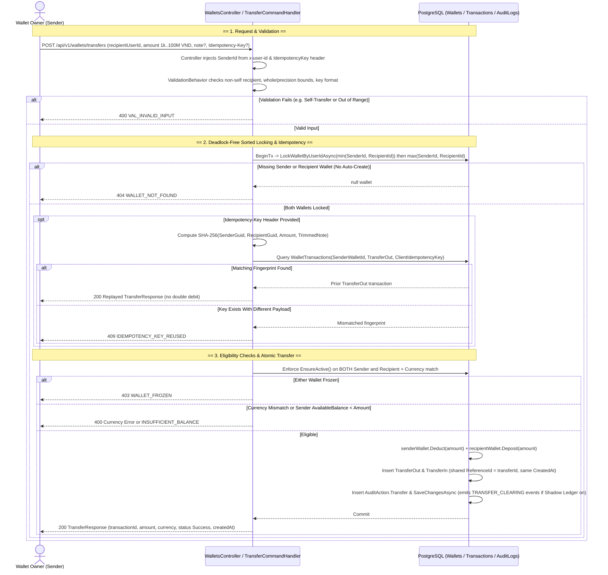

# Wallet-to-Wallet Transfers — Sequence Diagram

[Detailed walkthrough](05-transfers.md) | [Business overview](../business-use-cases.md) | [Shared request path](00-shared-request-path.md)

Atomic P2P VND wallet transfer with deadlock-free ascending `UserId` locking, optional `Idempotency-Key` SHA-256 verification, strict `Active` & `AvailableBalance` enforcement, and symmetric `TRANSFER_CLEARING` shadow-ledger capture.

