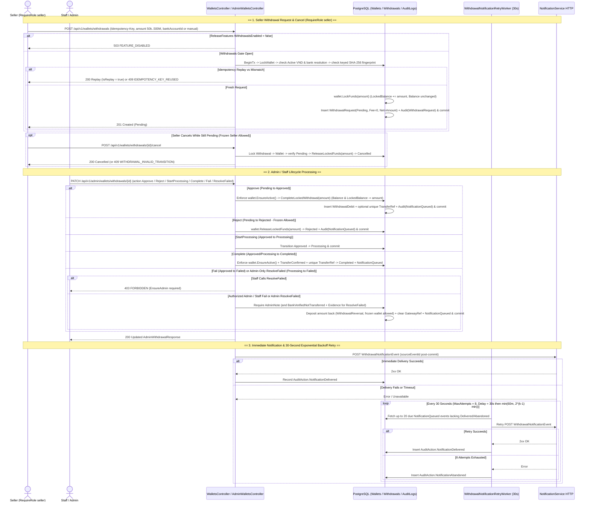

# Bank Withdrawals & Retry Notifications — Sequence Diagram

[Detailed walkthrough](06-withdrawals.md) | [Business overview](../business-use-cases.md) | [Bank accounts](01-wallet-and-history.diagram.md)

Complete seller withdrawal request and cancellation flow, staff/admin approval and completion state machine (`ResolveFailed` restricted to `admin` only), and immediate + 30-second exponential-backoff notification delivery.

