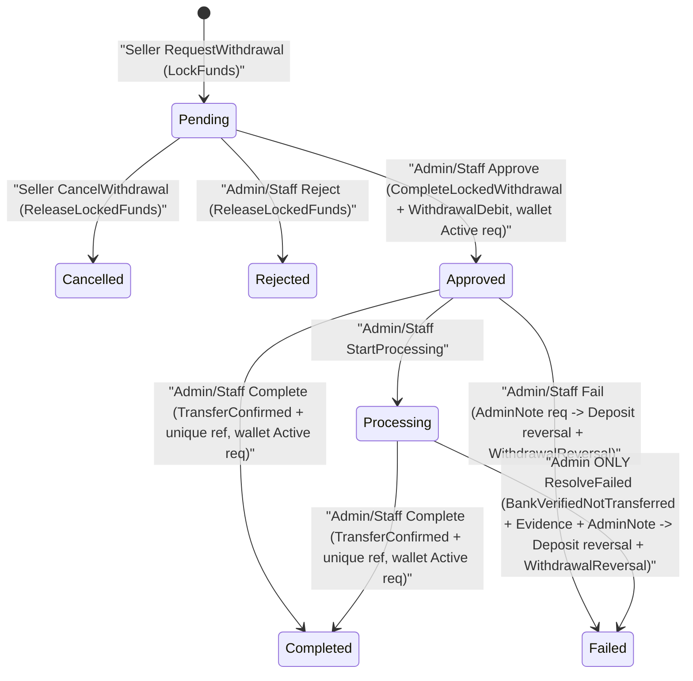

# Request, cancel, and process bank withdrawals

[Business overview](../business-use-cases.md) | [Shared request path](00-shared-request-path.md) | [Bank accounts](01-wallet-and-history.md#manage-saved-bank-accounts) | [Sequence diagram](06-withdrawals.diagram.md)

**Stories:**
- As a seller, I want to request a bank withdrawal (from a saved bank account or explicit bank details), view status/history, or cancel it while still pending.
- As staff or admin, I want to advance withdrawal lifecycle states, record verified bank transfer references, reverse failed payouts safely, and ensure delivery notifications retry automatically.

---

## Seller withdrawal request, listing & cancellation

All seller withdrawal routes require `[RequireRole("seller")]` (accepts `seller` and `admin`; **`staff` is rejected with `403 FORBIDDEN`**).

1. **Create request (`POST /api/v1/wallets/withdrawals`):**
   - Gated by `[ReleaseFeature(ReleaseFeature.Withdrawals)]` (`ReleaseFeatures:WithdrawalsEnabled`, default open in `Development`, closed elsewhere -> `503 FEATURE_DISABLED` when off).
   - Requires header `Idempotency-Key` (1–100 chars `[A-Za-z0-9-_]`), `amount` (`50,000`–`500,000,000` VND, `[MoneyPrecision]`), `currency: "VND"`, and either:
     - `bankAccountId` referencing a saved non-deleted `BankAccount` owned by the caller (`404 BANK_ACCOUNT_NOT_FOUND`), **or**
     - manual `bankCode`, `accountNumber`, `accountHolderName` (mutually exclusive with `bankAccountId`, `400 VAL_INVALID_INPUT`), **or**
     - neither, which resolves the caller's saved `IsDefault == true` bank account (`400 BANK_ACCOUNT_REQUIRED` if none exists).
   - [RequestWithdrawalCommandHandler](../../Wallet.Application/Features/Withdrawals/Commands/RequestWithdrawal/RequestWithdrawalCommandHandler.cs) locks the user's wallet (`404 WALLET_NOT_FOUND`), checks `wallet.EnsureActive()` (`403 WALLET_FROZEN`) and `Currency == Vnd`, computes SHA-256 fingerprint over `(walletId, amount, currency, bankName, accountNumber, accountHolder)`, and checks `(WalletId, ClientIdempotencyKey)`:
     - Matching fingerprint commits and returns `200 OK` (`IsReplay = true`).
     - Mismatched fingerprint throws `409 IDEMPOTENCY_KEY_REUSED`.
   - Calls `wallet.LockFunds(amount)` (`AvailableBalance >= amount` checked -> increments `LockedBalance`, leaving total `Balance` unchanged until approval), inserts `WithdrawalRequest` (`Status = Pending`, `Fee = 0`, `NetAmount = Amount`), writes `AuditAction.WithdrawalRequest`, commits, and returns `201 Created`.
2. **List & inspect (`GET /api/v1/wallets/withdrawals`, `GET /api/v1/wallets/withdrawals/{id:guid}`):**
   - [ListMyWithdrawalsQueryHandler](../../Wallet.Application/Features/Withdrawals/Queries/ListMyWithdrawals/ListMyWithdrawalsQueryHandler.cs) and [GetMyWithdrawalQueryHandler](../../Wallet.Application/Features/Withdrawals/Queries/GetMyWithdrawal/GetMyWithdrawalQueryHandler.cs) scope strictly by wallet owner (`404 WITHDRAWAL_NOT_FOUND`) and mask `accountNumber` (`MaskedAccountNumber`, last 4 digits only).
3. **Seller cancel (`POST /api/v1/wallets/withdrawals/{id:guid}/cancel`):**
   - [CancelWithdrawalCommandHandler](../../Wallet.Application/Features/Withdrawals/Commands/CancelWithdrawal/CancelWithdrawalCommandHandler.cs) locks withdrawal -> wallet (`404 WITHDRAWAL_NOT_FOUND` on non-owned), verifies `Status == Pending` (`409 WITHDRAWAL_INVALID_TRANSITION` otherwise), calls `wallet.ReleaseLockedFunds(amount)` (permitted even if wallet is frozen), sets `Status = Cancelled`, writes `AuditAction.WithdrawalCancel`, and returns `200`.

---

## Admin & staff processing state machine

Processing endpoints live on [AdminWalletsController](../../Wallet.Api/Controllers/Public/AdminWalletsController.cs) (`[RequireRole("admin", "staff")]`), are **not** blocked when `WithdrawalsEnabled = false`, and support the full `WithdrawalStatus` lifecycle ([ProcessWithdrawalCommandHandler](../../Wallet.Application/Features/AdminWallets/Commands/ProcessWithdrawal/ProcessWithdrawalCommandHandler.cs), [WithdrawalWorkflow](../../Wallet.Application/Features/Withdrawals/WithdrawalWorkflow.cs)):

| Action | Role | From State(s) -> To | Required Inputs & Financial / Wallet Effect |
|---|---|---|---|
| `Approve` | `admin` or `staff` | `Pending` -> `Approved` | Enforces `wallet.EnsureActive()`. Deducts **both** `LockedBalance` and `Balance` via `CompleteLockedWithdrawal(amount)` and creates `WithdrawalDebit` tx. Optional unique `TransferReference`/`ReferenceCode` (`409 TRANSFER_REFERENCE_ALREADY_USED`). |
| `Reject` | `admin` or `staff` | `Pending` -> `Rejected` | Releases `LockedBalance` (`ReleaseLockedFunds`), no `Balance` change; allowed even when wallet is frozen. |
| `StartProcessing` | `admin` or `staff` | `Approved` -> `Processing` | Operational handoff state marking bank transfer in flight; no balance change. |
| `Complete` | `admin` or `staff` | `Approved \| Processing` -> `Completed` | Enforces `wallet.EnsureActive()`. Requires `TransferConfirmed == true` and non-empty unique `TransferReference`/`ReferenceCode`; sets `CompletedAt`. No second debit (`WithdrawalDebit` happened on `Approve`). |
| `Fail` | `admin` or `staff` | `Approved` -> `Failed` | Requires 3–500 char `AdminNote`; allowed even when wallet is frozen. Deposits `amount` back to `Balance` (`WithdrawalReversal` tx) and clears `GatewayReferenceId`. |
| `ResolveFailed` | **`admin` ONLY** (`403 FORBIDDEN` for staff) | `Processing` -> `Failed` | Requires `BankVerifiedNotTransferred == true`, 3–500 char `VerificationEvidence`, and 3–500 char `AdminNote`; allowed even when wallet is frozen. Credits `amount` back (`WithdrawalReversal`) and clears `GatewayReferenceId`. |

Notice `WalletService` **does not execute bank transfers itself**—it tracks bank/ledger references and reverses funds cleanly if external payout fails.

## Admin inspection & sanitized audit history

- `GET /api/v1/admin/wallets/withdrawals` (`admin`/`staff`): paginated filter by `status`, `userId`, `transferReference`, `fromDate`/`toDate` returning `AdminWithdrawalResponse` (unmasked bank details for payout ops).
- `GET /api/v1/admin/wallets/withdrawals/{id:guid}/history` (`admin`/`staff`): returns `WithdrawalHistoryEntry[]` ordered chronologically; sensitive bank account fields (`BankAccountNumber`, `AccountNumber`, `VerificationEvidence`, etc.) are automatically redacted via `SanitizeAuditJson`.

## Outbound notifications & retry worker

When `ProcessWithdrawal` commits `Approve`, `Reject`, `Complete`, `Fail`, or `ResolveFailed`, it stages an `AuditAction.NotificationQueued` entry inside the **same database transaction**, then dispatches via `TryDispatchWithdrawalEventAsync` post-commit (`INotificationClient`, deterministic `sourceEventId`).

If immediate dispatch fails or the notification service is down, [WithdrawalNotificationRetryWorker](../../Wallet.Api/WithdrawalNotificationRetryWorker.cs) wakes every **30 seconds** and calls [WithdrawalNotificationRetry](../../Wallet.Application/Common/Extensions/WithdrawalNotificationRetry.cs) (batch size `20`):
- Waits `FirstAttemptDelay = 30s` after queueing.
- Retries up to `MaxAttempts = 8` with exponential backoff `min(60, 2^(failedAttempts - 1))` minutes (`1m, 2m, 4m, 8m, 16m, 32m, 60m`).
- Records `AuditAction.NotificationDelivered` on success or `AuditAction.NotificationAbandoned` after 8 failures.
