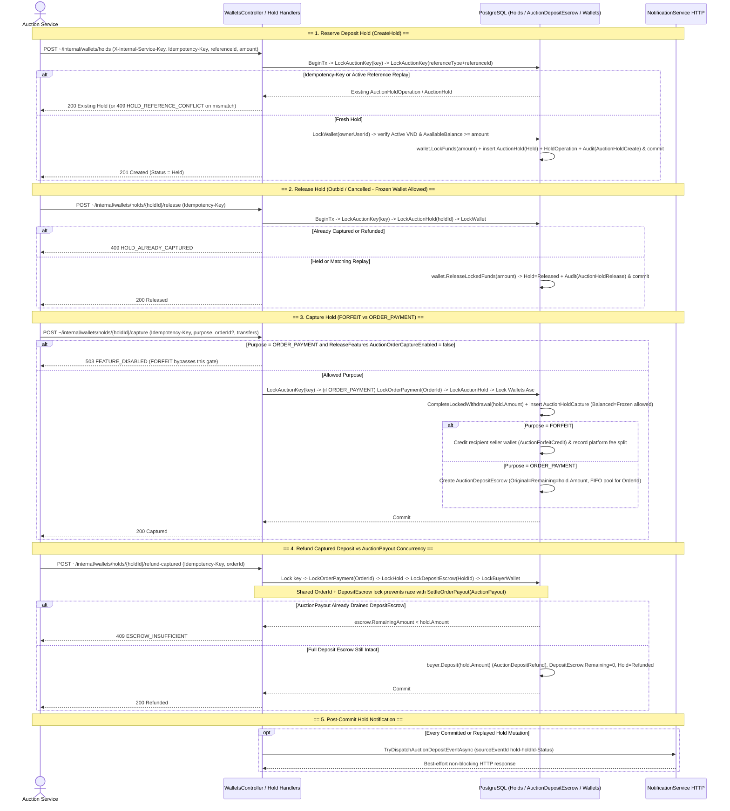

# Auction Deposit Holds, Capture & Refund Race Protection — Sequence Diagram

[Detailed walkthrough](07-auction-holds.md) | [Business overview](../business-use-cases.md) | [Wallet orders & escrow](04-wallet-orders.diagram.md)

Idempotent Auction hold operations authenticated via `[RequireAuctionServiceKey]` on `/api/v1/wallets/holds/...` and `~/api/v1/internal/wallets/holds/...`, highlighting shared lock ordering between `RefundCapturedHold` and `SettleOrderPayout(AuctionPayout)`.

