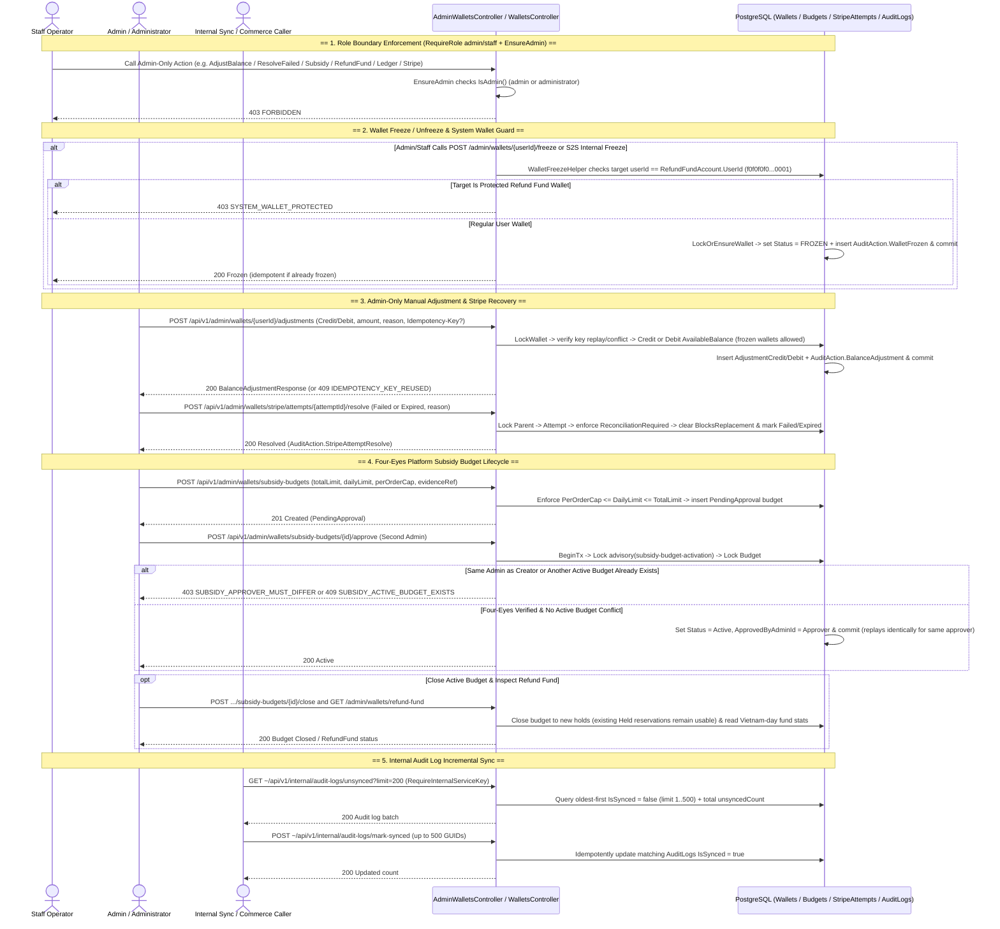

# Administration, Role Boundaries, Subsidies & Audit Sync — Sequence Diagram

[Detailed walkthrough](08-administration.md) | [Business overview](../business-use-cases.md) | [Withdrawals](06-withdrawals.diagram.md)

Role separation between `staff` (9 read/freeze/standard-withdrawal actions) and `admin` (23 admin-only financial, recovery, subsidy, refund-fund, and ledger operations), system-wallet freeze protection (`RefundFundAccount`), 4-eyes subsidy budget activation, and internal audit log sync.

