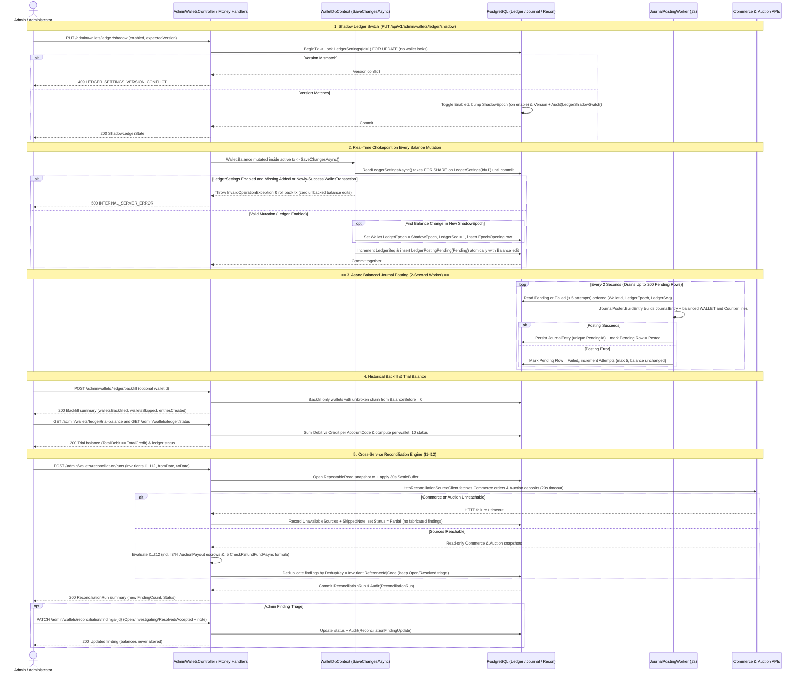

# Shadow Ledger & Cross-Service Reconciliation (I1-I12) — Sequence Diagram

[Detailed walkthrough](09-shadow-ledger-and-reconciliation.md) | [Business overview](../business-use-cases.md) | [Reconciliation catalog](../RECONCILIATION_CATALOG.md)

Real-time `WalletDbContext.SaveChangesAsync` shadow-ledger chokepoint, 2-second balanced double-entry `JournalPostingWorker`, backfill/trial-balance controls, and snapshot reconciliation across `WalletService`, Commerce, and Auction (`I1`–`I12`).

